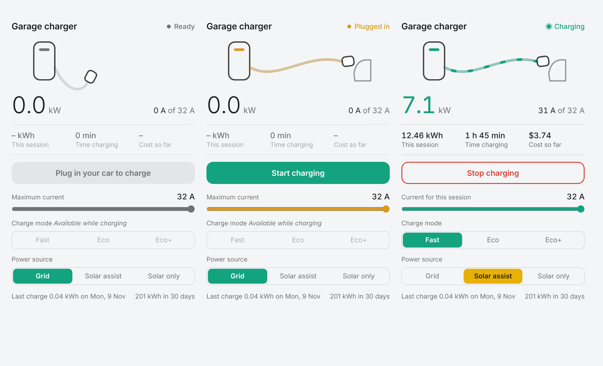

# Ocular IQ EV Charger for Home Assistant (cloud)

A custom integration that signs in to the **Ocular cloud**, the same backend the Ocular app uses. Your charger stays connected to Ocular, so the app keeps working, and Home Assistant gets live status, control and charging history.

> Unofficial. Not affiliated with Ocular / Eve Australia. The API was mapped from the Ocular Android app v1.7.9 and isn't a published interface, so it may change.

## Install

**HACS (custom repository)**
1. HACS → ⋮ → *Custom repositories* → add `https://github.com/rickevans86/HomeAssistant_OcularIQ`, category **Integration**.
2. Install **Ocular EV Charger (Cloud)** and restart Home Assistant.

**Manual:** copy `custom_components/ocular` into your `config/custom_components/` folder and restart.

Then go to **Settings → Devices & services → Add integration → Ocular** and sign in with your Ocular app email and password. Only the hashed password the app sends is stored. The plain password is never saved.

## What you get (per charger)

| Type | Entities |
|---|---|
| Sensors | Status, Plug status, Charging current (A), Active current limit, Charging power (estimated, kW), Session time, Session cost, Electricity price, Session energy (kWh), Session start, Session mode, Solar mode |
| History | Last session energy / duration / end, Energy last 30 days. The `sessions` attribute lists up to 50 recent sessions with kWh, cost and user |
| Binary sensors | Plugged in, Charging, Online |
| Switches | **Charge** (on = remote start, off = remote stop), Plug and charge |
| Numbers | Session current limit (only while charging), Default current limit |
| Selects | Session charge mode (Fast / Eco / EcoPlus, while charging), Solar charging mode (Fast / Solar Assist / Solar, on chargers with a built-in solar gateway) |
| Buttons | Refresh status, Refresh history, Reboot charger |
| Diagnostic | *Raw cloud data* sensor (disabled by default) holding every field the cloud returns |

Live status is polled every 30 s by default (configurable under the integration's **Configure** button). History is refreshed every 15 min.

**Power is estimated** as current × 230 V (× 3 for 22 kW models), because the cloud only reports live amps.

## Dashboard card



The integration comes with its own card, which loads automatically, so there's no separate download. Edit a dashboard, choose **Add card**, and pick **Ocular charger**, or use YAML:

```yaml
type: custom:ocular-charger-card
# all optional:
device_id: <your charger>   # defaults to the first Ocular charger
name: Garage charger
show_controls: true          # current slider and mode buttons
show_history: true           # last charge and 30-day total
```

The card shows live power, current, session energy, time and cost, a Start/Stop button that only lights up when the car is plugged in, a current slider, the Fast/Eco/Eco+ session modes, and Grid/Solar assist/Solar only. Tap any figure to open its history.

If the card doesn't appear right after an update, refresh your browser.

## Logs and troubleshooting

To see every request and response:

```yaml
logger:
  logs:
    custom_components.ocular: debug
```

You can also use **Settings → Devices & services → Ocular → ⋮ → Download diagnostics** to get the raw cloud data, with personal fields redacted. Please attach it when you report a problem.

## API notes

Base URL `https://ocpp.ocularcharging.com.au:9110/`. Login is `POST family-user-service/auth/login/customer` with `{"username", "password": md5(md5(password))}`, followed by `Authorization: bearer <accessToken>`. Every response is `{"code", "message", "data"}`. See `custom_components/ocular/api.py` for every endpoint that's used.
